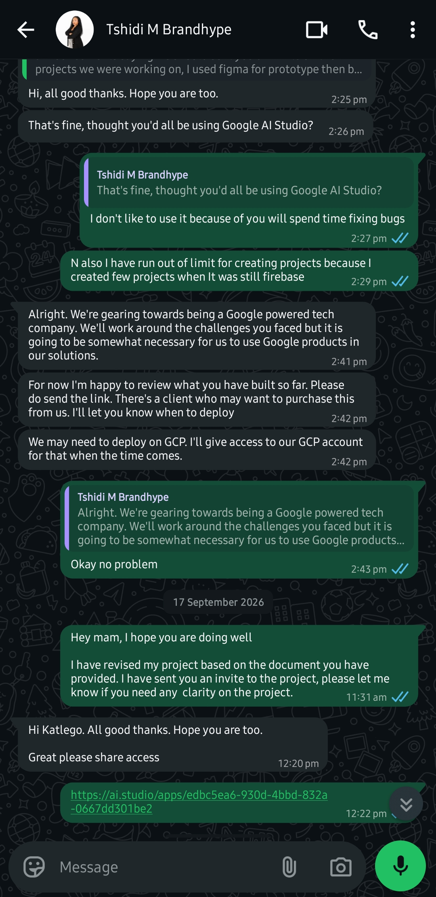
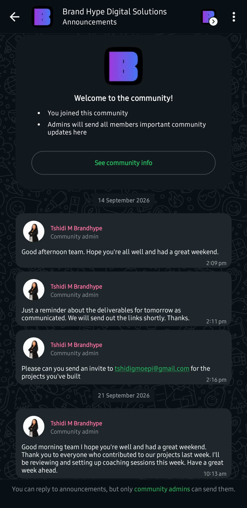
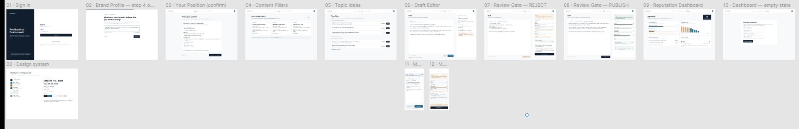
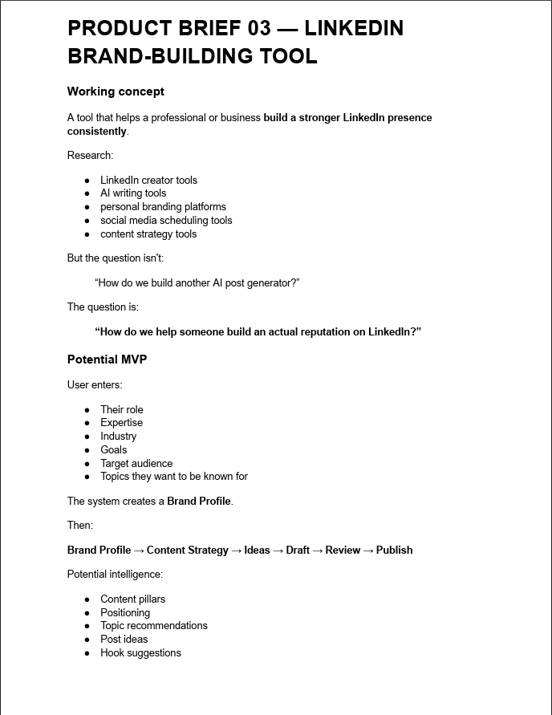
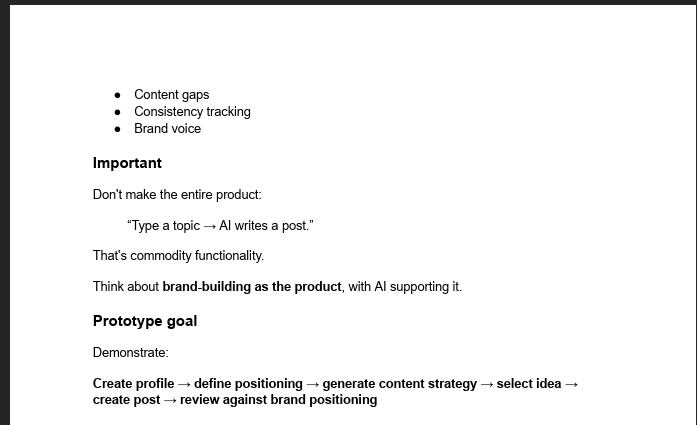
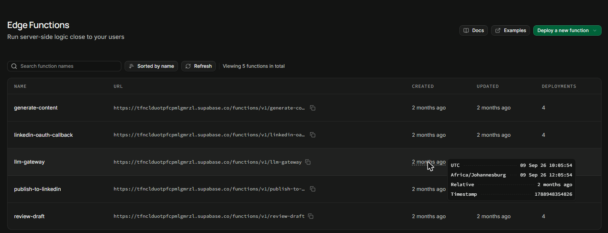

# 👋 Hey, I'm Katlego Jeffrey Malaka

<p align="center"><strong>Application Development Student · Future Software Architect · Cape Town, ZA</strong></p>
<p align="center">
<a href="https://linkedin.com/in/katlego-jeffrey-malaka-820a8726a"></a>
<a href="https://github.com/KJMalaka"></a>
<a href="https://katlego-malaka.vercel.app"></a>
<a href="mailto:230443370@mycput.ac.za"></a>
</p>

<p align="center">
  🔗 <strong>Live Portfolio:</strong> <a href="https://kjmalaka.github.io/Portfolio-CV/">https://kjmalaka.github.io/Portfolio-CV/</a>
</p>
<br>

## 📑 Contents

| Section | |
|---|---|
| 🧠 [About Me](#about-me) | 🛠 [Technical Skills](#technical-skills) |
| 🎓 [Education](#education) | 📝 [Portfolio Reflections](#portfolio-reflections) |
| 🧩 [**Agile Portfolio: Standpoint** *(Assessment 2)*](#agile-portfolio) | 📬 [References](#references) |

<br>

<a id="about-me"></a>

## 🧠 About Me

I'm a **final-year ICT: Application Development** student at CPUT, currently completing my **Work Integrated Learning (WIL)** placement at **BrandHype** through CAPACITI's AI Foundations Programme. I've taken on project lead and developer roles across full-stack, backend, and desktop applications, gaining hands-on experience with Agile/Scrum, REST API design, and real-world deployment pipelines.

My academic journey is fuelled by a deep interest in **software architecture**, **AI/ML**, and building technology that solves real problems for real people. I genuinely enjoy participating in hackathons as they push me to think fast, collaborate under pressure, and turn ideas into working products within tight timeframes. They have become one of my favourite ways to grow as a developer and test what I am truly capable of.


<br>

## 🎓 GitHub Student Account Evidence

| Field | Details |
|-------|---------|
| Username | KJMalaka |
| Student Email | 230443370@mycput.ac.za |
| Verification | GitHub Education verified via CPUT partnership |

<br>

<a id="education"></a>

## 🎓 Education

| Qualification | Institution | Year |
|---|---|---|
| 📄 National Senior Certificate | Motswatemeng Secondary School | 2020 |
| 🎓 Higher Certificate in ICT | Cape Peninsula University of Technology | 2023 |
| 🎓 Diploma in ICT: Application Development *(Final Year)* | Cape Peninsula University of Technology | 2024 to 2026 |

<br>


<a id="technical-skills"></a>

## 🛠 Technical Skills

| Category | Technologies |
|---|---|
| **Languages & Frameworks** |          |
| **Databases** |     |
| **Tools & Practices** |       |

<br>


<a id="portfolio-reflections"></a>

## 📝 Portfolio Reflections

> *These reflections follow the STAR method (Situation, Task, Action, Result) to document key milestones in building this portfolio.*

<br>

### 📄 CV Using Markdown Reflection

**Situation**

For my PRP372s Project Presentation 3 assessment at CPUT, I was required to build a digital portfolio using Markdown rather than traditional word processors or design tools.

**Task**

I needed to design, structure, and code my entire portfolio and CV using GitHub Flavoured Markdown, ensuring it was well-organized, readable, and showcased my work readiness training effectively.

**Action**

I structured my portfolio into multiple Markdown files using headers and subheaders for information hierarchy, tables for skills and awards, badges for visual engagement, and relative links to create a navigable mini-site. I also ensured my Markdown followed GFM conventions including proper formatting syntax.

**Result**

Coding in Markdown forced me to focus on content clarity and structure rather than visual design, a skill that translates directly to writing clear documentation and README files in professional development teams. My portfolio is now version-controlled, easily maintainable, and demonstrates my ability to communicate effectively using developer-standard tools.

<br>

### 🎥 Mock Interview Reflection

**Situation**

Academic excellence and coding skill alone do not win placements because communication matters just as much. I needed to step away from the keyboard and prove I could articulate my thought process clearly under pressure.

**Task**

I was required to record a professional mock interview session where I could explain my development approach, my contributions to team environments like Abantu Tech, and how I handle real-world challenges such as the MICT SETA National Skills Challenge.

**Action**

To be honest, I was nervous when recording this video. I was fighting against time and I struggled to maintain consistent eye contact with the camera, which reminded me how different performing under pressure feels compared to writing code. Despite that, I prepared structured talking points that connected my technical decisions to business outcomes. Rather than just listing what I did, I focused on *why* I made specific choices, for example, why we chose Next.js 15 for QueUp and how we navigated deployment issues under hackathon time pressure.

**Result**

The experience was humbling but valuable. It showed me that communication is a skill that needs as much practice as programming, and I now understand the importance of building confidence in front of an audience just as much as building confidence in front of a screen.

<div align="center">
  <video width="600" controls>
    <source src="Mock%20Interview.mp4" type="video/mp4">
  </video>
  <p>▶️ <a href="https://github.com/KJMalaka/Portfolio-CV/raw/main/Mock%20Interview.mp4">Watch or download the mock interview video</a></p>
</div>

<br>

### 🌐 Deploying via GitHub Pages Reflection
**Situation**

My repository was functional and well-documented, but it existed only for technical viewers who already knew how to navigate GitHub. A recruiter or client should not need to clone a repo to see my work.

**Task**

I needed to use GitHub Pages to transform the repository into a live, professionally accessible portfolio with a real URL I could share in emails, LinkedIn messages, and job applications.

**Action**

This was not my first time using GitHub Pages. I had prior experience deploying websites through it for academic and personal projects, so I came into this with a working understanding of how static site hosting and branch-based deployment work. I applied that experience to optimise my `README.md` with clean Markdown syntax including badges, tables, and clear visual hierarchy, then configured GitHub Pages to deploy directly from the main branch. That prior knowledge helped me troubleshoot rendering issues quickly and ensure everything resolved correctly in the hosted environment.

**Result**

The result is a live, professional URL that demonstrates I understand the full lifecycle of software, from writing code to documenting, versioning, and deploying it for the world to see. That end-to-end ownership is exactly what employers look for in a developer.

<br>


<a id="agile-portfolio"></a>

## 🧩 Agile Portfolio: Standpoint

<p align="center"><strong>PRP372S Project Presentation 3 · Assessment 2 · Agile Evidence and Reflection</strong></p>

<p align="center">
  <a href="https://figma.com/design/Xq83oM9WRNdijb1IPRYOX7"></a>
  <a href="https://ai.studio/apps/edbc5ea6-930d-4bbd-832a-0667dd301be2"></a>
</p>

<br>

### 📌 About This Project

During my Work Integrated Learning placement at **BrandHype** (through CAPACITI), I took part in a one-week individual product sprint. I was given one product brief and had to take it from a real problem to a working, tested prototype, then present it to the BrandHype team.

I owned **Product Brief 03: the LinkedIn brand-building tool**. I called it **Standpoint**.

> *A LinkedIn positioning system that refuses to let you publish content anyone else could have written.*

| | |
|---|---|
| **Sprint** | 8 to 15 September 2026 |
| **My role** | Product owner and builder: research, product definition, prototype, build, testing and presentation |
| **Supervisor** | Tshidi, BrandHype |
| **Stack** | React, Vite, TypeScript, Tailwind CSS, Supabase (Postgres, Auth, RLS, Edge Functions), Groq, LinkedIn OIDC and Share API |
| **Tools** | Figma, Google AI Studio, ChatGPT, Supabase, Clockify, WhatsApp |
| **Scale** | 9 tables · 7 migrations · 5 Edge Functions · 13 Figma frames |
| **Try it** | 🔗 [Standpoint live app (Google AI Studio)](https://ai.studio/apps/edbc5ea6-930d-4bbd-832a-0667dd301be2) · 🎨 [Figma prototype](https://figma.com/design/Xq83oM9WRNdijb1IPRYOX7) |

**The problem.** Every LinkedIn tool I researched (Taplio, Supergrow, Kleo, AuthoredUp, EasyGen) treats the *post* as the unit of work and frequency as the measure of success. You can post for six months, gain impressions and still have no clear reputation. The alternative, a human ghostwriter, costs roughly R25 000 to R60 000 a year.

**My answer.** Standpoint treats the *position* as the unit of work. You declare what you stand for first, including at least one contrarian belief and the things you refuse to argue. Every draft is then scored by an adversarial review gate, and only a PUBLISH verdict lets it go out.

<br>

#### 📑 Agile Contents

- [How This Portfolio Is Built](#method)
- [1. Agile Team Charter](#charter)
- [2. User Stories and Tasks](#stories)
- [3. Product Backlog](#product-backlog)
- [4. Sprint Backlog](#sprint-backlog)
- [5. Agile Logbook](#logbook)
- [Connecting the Evidence](#connecting)
- [Overall Agile Reflection](#overall)
- [Agile References](#agile-references)

<br>

---

<a id="method"></a>

### 🧭 How This Portfolio Is Built

I followed the four e-portfolio steps from the assessment brief, so each section shows evidence first and then reflection.

| Step | What I did |
|---|---|
| **Collect** | Gathered everything I produced during the sprint: documents, prototype, prompts, time logs and WhatsApp messages |
| **Select** | Chose the artefacts that best prove each Agile practice, and left out anything confidential |
| **Reflect** | Wrote a STAR reflection for each practice, ending with how my thinking changed |
| **Connect** | Traced one story (the review gate) through every artefact to show how they fit together |

#### 🗂 Evidence Index

Every claim on this page comes from one of these dated sources.

| Artefact | Date | What it proves | Used in |
|---|---|---|---|
| [Intern Product Development Sprint brief (PDF)](evidence/INTERN%20PRODUCT%20DEVELOPMENT%20SPRINT.pdf) | Sep 2026 | Sprint goal, daily plan, working agreements, Definition of Done | Charter, Sprint Backlog |
| Product Definition document | 9 Sep 2026 | Problem, persona, research, MVP scope, cut list, my Definition of Done | Stories, Product Backlog |
| Figma prototype (13 frames, 3 flows) | 8 Sep 2026 | Design before build | Stories, Sprint Backlog |
| [Prompt Log (PDF)](evidence/Standpoint_Prompt_Log.pdf) | 10 Sep 2026 | Build brief, phase checkpoints, review gate prompt, Groq pivot | Sprint Backlog, Logbook |
| [Systems Report (PDF)](evidence/Standpoint_Systems_Report.pdf) | 10 Sep 2026 | Architecture, data model, enforcement rules, build status | Stories, Sprint Backlog |
| Presentation deck | 15 Sep 2026 | Sprint review and retrospective | Logbook |
| Supabase project and Edge Function timestamps | 9 Sep 2026 | Exact times the build phases were created and deployed | Sprint Backlog, Logbook |
| Working hours (Clockify used during the sprint) | 8 to 15 Sep 2026 | Estimated time per phase (see note in Sprint Backlog) | Sprint Backlog, Logbook |
| WhatsApp: chat with my supervisor and BrandHype announcements | 14 to 21 Sep 2026 | Escalation, supervisor direction, deadlines and review in use | Charter, Product Backlog |


<br>

---

<a id="charter"></a>

### 1. 🤝 Agile Team Charter

A team charter sets out a team's purpose, operating agreements and boundaries so that everyone works the same way (Kloppenborg, Anantatmula and Wells, 2023). Standpoint was an individual product, so this charter covers the people who were actually involved in it: me as product owner and builder, my supervisor as stakeholder, and my peer tester. It also sets out the working agreements I held myself to.

#### Evidence

**Purpose:** take Product Brief 03 from zero to a working, tested prototype in one sprint, and present it to the BrandHype team on Tuesday 15 September 2026.

**Sprint goal:** a new user can complete the full journey from sign-in to a scored draft, and the review gate returns genuinely different verdicts for a strong draft and a generic one.

##### Roles

| Person | Role | Responsibilities |
|---|---|---|
| Katlego Malaka | Product owner and builder | Research, product definition, prioritisation, prototype, build, testing and presentation |
| Tshidi (BrandHype) | Supervisor and stakeholder | Sets direction, reviews work and gives feedback at the sprint review |
| Dumisane Madondo | Peer tester | Uses Standpoint without instructions and reports where he gets stuck or confused |

##### Core Values

- **Ownership:** I'm responsible for Standpoint from start to finish, and I don't wait to be told every feature to build
- **Research first, build second:** no builder opens before the problem and user are defined
- **Honest testing:** finding a problem is part of the process, not a failure
- **Think, don't just prompt:** AI tools support my thinking, they don't replace it

##### Working Agreements

| Area | Agreement |
|---|---|
| Working days | Tuesday 8 to Friday 11 September, plus Tuesday 15 September for the presentation. No Mondays or weekends. |
| Communication | BrandHype WhatsApp group for updates and questions to my supervisor. |
| Asking for help | Try first, then escalate using: **problem → what I tried → what happened → what I think we should try next** |
| Peer testing | Dumisane uses the product without instructions, so I can see where a real user gets stuck |
| Time tracking | All work logged in Clockify |
| AI use | Use AI to plan and write prompts before building, not to "make it better" thirty times. Keep sensitive data and API keys out of prompts and client code. |

##### Definition of Done

From the [sprint brief](evidence/INTERN%20PRODUCT%20DEVELOPMENT%20SPRINT.pdf):
- [x] Research covering 3 to 5 competitor tools and user pain points
- [x] Target user, problem statement and MVP scope defined
- [x] Wireframes of the core user journey
- [x] Working prototype of that journey
- [x] Tested with new users, empty data, wrong inputs and mobile
- [x] Feedback from at least one other person
- [x] Presentation covering problem, research, solution, demo and next steps

My extra criteria for Standpoint:
- [x] The review gate returns different verdicts for a strong draft and a generic one
- [x] Product rules are enforced on the server, not just in the UI
- [x] Demo rehearsed end to end three times with a seeded archive

##### Boundaries

- Don't build features I can't explain
- Keep the MVP to one core workflow
- Don't put sensitive information into AI prompts
- Don't expose API keys or private user data

##### Decisions and Escalation

| Situation | How it's handled |
|---|---|
| Product decisions (scope, features, priorities) | I decide as product owner, based on my research and the brief |
| Direction or scope questions beyond the brief | Raised with Tshidi |
| Feedback from peer testing | Dumisane explains what he saw; I decide what to change and record it in the backlog |
| Stuck for too long | Escalate using the agreed format instead of waiting |

##### The Charter in Use

A charter is a living document, so here is how each agreement actually showed up during the sprint.

| Agreement | Where it showed up | What changed |
|---|---|---|
| Research first, build second | Research and product definition done on 8 Sep, before the Supabase project was created at 08:57 on 9 Sep | Nothing. It held. |
| AI use: plan prompts before building | Full prompt log kept, with the reason behind each prompt | I added my own rule: AI calls go through one gateway only |
| Asking for help | I told Tshidi why I hadn't built in Google AI Studio: it was costing me time fixing bugs, and I had hit its project limit | She agreed to work around it for now, but set the direction that BrandHype's solutions should use Google products. I revised Standpoint in Google AI Studio and shared it with her on 17 Sep. |
| Supervisor review | BrandHype announced the deliverable deadline and asked for project invites to be sent for review | I sent my project link, and Tshidi reviewed it and set up coaching sessions the following week |
| Peer testing | Dumisane Madondo tested Standpoint without instructions on 10 Sep | He completed the full journey from sign-in to a scored draft without getting stuck, so no fixes were needed from his test |
| Definition of Done | The brief's version was general | I added stricter criteria for Standpoint in my product definition |

*The working agreements came from the [sprint brief](evidence/INTERN%20PRODUCT%20DEVELOPMENT%20SPRINT.pdf). I wrote them up as a charter for this portfolio.*

📎 **Supporting evidence**

<p align="center">
  
  &nbsp;&nbsp;
  
</p>

*Left: my chat with Tshidi, explaining a tool problem, getting direction on Google products, and sharing my revised project for review (17 Sep). Commercial details removed. Right: BrandHype announcements, with the deliverables deadline reminder (14 Sep), the request to share projects for review, and the follow-up on coaching (21 Sep). Email address blurred.*

<br>

#### Reflection

**Situation**

The BrandHype sprint was an individual product challenge. I owned Standpoint on my own, but I wasn't working without structure: I had a supervisor setting direction, a fixed one-week timeline, a presentation at the end and a peer tester who would use my product with no instructions.

**Task**

I needed clear roles and working agreements so that working alone didn't mean working without accountability or feedback.

**Action**

Most of my agreements came from the sprint brief, and WhatsApp kept me connected to my supervisor day to day. The agreement that shaped my work most was the AI rule: plan the prompt before you build. I took it seriously enough to keep a full prompt log, so every major prompt I sent is on record with a note on why it was structured that way. The escalation format helped too. When Tshidi asked why I wasn't using Google AI Studio, I explained the problem honestly: it was costing me time fixing bugs and I'd hit its project limit. She didn't just accept it. She agreed to work around it for now, but made it clear that BrandHype's solutions need to use Google products, so I revised Standpoint in AI Studio. That showed me escalating isn't only about getting unstuck, it's also how you find out what the stakeholder really needs. Asking Dumisane to test without instructions was the agreement that mattered most for quality, because I already knew how the product worked and couldn't see it the way a new user would.

**Result**

A charter matters even when you're the only one building. The values were nice to have, but the practical agreements did the real work: when I work, how I ask for help, who gives me feedback and what done means. The brief's Definition of Done was general, so I wrote a stricter one for Standpoint: the review gate had to return different verdicts for a strong draft and a generic one, and the demo had to be rehearsed three times. One thing I'd change: Dumisane was my only peer tester. He got through the whole journey without getting stuck, which was good to see, but one tester isn't much evidence. Next time I'd want at least two, and I'd also agree a fixed daily check-in time with my supervisor from day one.

> **🔄 How my thinking changed:** I used to see a charter as paperwork for group projects. Now I see it works for solo work too: clear roles and agreements gave me accountability and honest feedback even though I was the only one building.

<br>

---

<a id="stories"></a>

### 2. 📝 User Stories and Tasks

#### Evidence

**Primary user:** an independent senior professional whose income depends on being trusted in a narrow domain: consultants, fractional executives, specialist advisors and technical founders.

**Persona:** *Nomsa Dlamini, 38, B2B SaaS pricing consultant in Cape Town.* She has run 14 pricing migrations and has her own method. She posts in bursts, cancelled an AI writing tool because she spent 20 minutes rewriting every draft, and softens her contrarian views before posting. Her success metric is a Head of Product messaging her to say *"I read your piece on discount authority."*

**Core user journey**

```
Sign in → Brand Profile → Confirm Position → Pillars → Ideas → Draft → Review Gate → Publish → Dashboard
```

**Format:** As a [user], I want [action], so that [benefit] (Cohn, 2004). Prioritised with MoSCoW (Must, Should, Could, Won't).

<br>

##### US-01: Sign In · Must
> **As a** consultant, **I want** to sign in with email or LinkedIn, **so that** my belief graph and drafts are private to me.

**Acceptance criteria:** email and LinkedIn OIDC sign-in work · LinkedIn scope is publish-only, never connections or messages · Row Level Security means a user can only read their own rows · a seeded demo account works without email delivery
**Tasks:** T-01.1 Set up Supabase Auth · T-01.2 Configure Sign In with LinkedIn (OIDC) · T-01.3 Write RLS policies on every table · T-01.4 Seed demo account · T-01.5 Prove a second user can't read the first user's rows

##### US-02: Build My Brand Profile · Must
> **As a** consultant, **I want** a short interview that captures my role, ideal client and their pains, **so that** the product understands my world before it suggests anything.

**Acceptance criteria:** six-step interview with validation · captures role, ICP title, ICP industry and ICP pains · answers can be entered manually or extracted by AI and then edited · extraction never invents anything the user didn't say
**Tasks:** T-02.1 Design the six interview steps in Figma · T-02.2 Build the interview form · T-02.3 Write the profile extraction prompt (fail closed on thin input) · T-02.4 Add edit and confirm step · T-02.5 Design the empty state

##### US-03: Declare My Position · Must
> **As a** consultant, **I want** to state my core stances, at least one contrarian belief and the positions I refuse to argue, **so that** my content builds a reputation instead of sounding like everyone else.

**Acceptance criteria:** at least one contrarian belief is required before continuing · anti-positions can be added with a reason · a single "Your Position" screen shows domains, stances, contrarian beliefs, anti-positions and proof · the user confirms it deliberately
**Tasks:** T-03.1 Create stances and anti_positions tables · T-03.2 Build stance and anti-position forms · T-03.3 Build the position confirmation screen · T-03.4 Add the database trigger that blocks pillars until a contrarian stance exists

##### US-04: Set My Content Pillars · Must
> **As a** consultant, **I want** two or three content pillars, each tied to a stance and an audience problem, **so that** I build authority in a few domains instead of spreading thin.

**Acceptance criteria:** pillars can be generated or written manually · each pillar links to an existing stance and a target pain · minimum two to proceed · a fourth pillar is blocked server-side, not just in the UI
**Tasks:** T-04.1 Create pillars table with NOT NULL stance link · T-04.2 Add pillar cap trigger · T-04.3 Write the pillar suggestion prompt (must pick an existing stance index) · T-04.4 Build pillar screen with edit · T-04.5 Design empty state

##### US-05: Get Ideas From My Stances · Must
> **As a** consultant, **I want** post ideas derived from my stances rather than trending topics, **so that** I never fall back on generic content in month four.

**Acceptance criteria:** four ideas per pillar, one for each angle type (contrarian, framework, evidence, story) · each idea carries a pillar and target pain · no generic topic labels like "Tips for better deploys"
**Tasks:** T-05.1 Create ideas table with angle_type enum · T-05.2 Write the idea suggestion prompt · T-05.3 Build ideas view per pillar · T-05.4 Test for generic output and tighten the prompt

##### US-06: Write With My Position Visible · Must
> **As a** consultant, **I want** my pillar, stance and anti-positions visible while I write, **so that** I don't soften my view or drift off-topic.

**Acceptance criteria:** stance panel is always visible beside the draft, not behind a tab · works at 390px mobile width · a draft can't exist without an idea · publish button stays disabled until review has run
**Tasks:** T-06.1 Create drafts table with NOT NULL idea link · T-06.2 Build editor with persistent stance panel · T-06.3 Build mobile layout at 390px · T-06.4 Save and reload drafts

##### US-07: Review Gate · Must
> **As a** consultant, **I want** every draft judged against my position by a critic that has no reason to approve it, **so that** I never publish something weak under my name.

**Acceptance criteria:** a separate adversarial prompt, never the generation prompt, scores pillar fit, stance alignment, substitutability, evidence specificity and AI-slop risk, and checks for anti-position hits and contradictions with past posts · REJECT if an anti-position is hit, stance alignment < 30 or substitutability > 75 · REVISE if evidence < 40, slop risk > 60 or a contradiction is found · otherwise PUBLISH · every fix references the user's own material · REJECT is shown in amber, never red
**Tasks:** T-07.1 Write the adversarial review prompt · T-07.2 Build the review-draft Edge Function and payload · T-07.3 Store results in review_results · T-07.4 Build verdict screens (REJECT, REVISE, PUBLISH) · T-07.5 Test with a deliberately generic draft · T-07.6 Tune thresholds against false REJECTs

##### US-08: Publish to LinkedIn · Must
> **As a** consultant, **I want** to publish an approved draft straight to LinkedIn, **so that** I don't have to copy and paste.

**Acceptance criteria:** only a PUBLISH verdict unlocks publishing · enforced by the publish_draft() SECURITY DEFINER function, with RLS blocking direct inserts · a real LinkedIn URN is stored · if OAuth isn't configured, the user gets an honest error, never a fake success
**Tasks:** T-08.1 Write publish_draft() RPC · T-08.2 Build publish-to-linkedin and OAuth callback Edge Functions · T-08.3 Handle token errors honestly · T-08.4 Test that REJECT and REVISE can't publish

##### US-09: Reputation Dashboard · Should
> **As a** consultant, **I want** to see whether I'm building a clear position, **so that** I can answer "is this working?" without vanity metrics.

**Acceptance criteria:** shows pillar coverage balance, substitutability trend, audience problem coverage and stance advancement rate · computed only from Standpoint's own tables · no impressions, likes or followers anywhere · has a designed empty state
**Tasks:** T-09.1 Write metric queries · T-09.2 Build dashboard screen · T-09.3 Design empty state · T-09.4 Seed archive data for the demo

##### Enabler stories

| ID | Enabler | Why it's needed |
|---|---|---|
| EN-01 | Database schema: 9 tables, strict FK chain (draft → idea → pillar → stance), RLS on every table | Every product rule is enforced here, not in the UI |
| EN-02 | llm-gateway Edge Function: the only code path that calls the AI provider, key stored in Supabase secrets | Keeps the API key out of the client and makes the provider swappable |

📎 **Supporting evidence**

<p align="center">
  
</p>
*The 13-frame Figma prototype, built before any code, covering the main flow, the first run and mobile.*

<br>

#### Reflection

**Situation**

The brief warned us not to build another "type a topic, AI writes a post" tool. My research showed exactly why: every tool in the category helps you post more, and none of them stores what you actually believe.

**Task**

I had to turn "help someone build a real reputation" into stories small enough to build, test and demo in four working days.

**Action**

I wrote Nomsa as a persona first, and every story is written from her side. That stopped me from adding features just because competitors had them. The hardest part was the acceptance criteria, because Standpoint's value lives in its rules: you can't create a pillar without a contrarian belief, you can't have more than three pillars, and you can't publish without a PUBLISH verdict. I wrote each rule as an acceptance criterion and said it had to be enforced on the server, not just with a disabled button. I also added two enabler stories for the schema and the AI gateway. Users never see them, but every user-facing story depends on them.

**Result**

The acceptance criteria became my test plan. For US-07, "a deliberately generic draft returns REJECT and publishing is blocked server-side" was the exact checkpoint I tested against. One story changed during the build: US-05's "no generic topic labels" criterion came from a testing failure. The idea generator kept returning things like "Tips for better deploys", so I added that rule to the prompt. Every story was working in the final demo. Next time I'd write the acceptance criteria first, before deciding priorities, because the criteria are what showed me how much work US-07 really was.

> **🔄 How my thinking changed:** I used to write user stories as feature descriptions. Now I see acceptance criteria as the test plan and the place where the product's rules live.

<br>

---

<a id="product-backlog"></a>

### 3. 📚 Product Backlog

#### Evidence

The full, prioritised list of work for Standpoint. It covers research, enablers, features, cuts and Sprint 2 candidates.

| Rank | ID | Item | Type | Priority | Status |
|---|---|---|---|---|---|
| 1 | R-01 | Market teardown and competitor review (Taplio, Supergrow, Kleo, AuthoredUp, EasyGen) | Research | Must | ✅ Done |
| 2 | R-02 | Product definition: problem, persona, journey, MVP scope, cut list | Research | Must | ✅ Done |
| 3 | R-03 | Figma prototype: 13 frames, 3 wired flows | Design | Must | ✅ Done |
| 4 | R-04 | Build brief and prompt log (Role + Context + Objective + User + Functionality + Constraints + Output) | Planning | Must | ✅ Done |
| 5 | EN-01 | Schema, FK chain and RLS on all 9 tables | Enabler | Must | ✅ Done |
| 6 | US-01 | Sign in (email and LinkedIn OIDC) | Feature | Must | ✅ Done |
| 7 | US-02 | Brand profile interview | Feature | Must | ✅ Done |
| 8 | US-03 | Declare position (stances, contrarian belief, anti-positions) | Feature | Must | ✅ Done |
| 9 | US-04 | Content pillars (max 3) | Feature | Must | ✅ Done |
| 10 | US-06 | Draft editor with persistent stance panel | Feature | Must | ✅ Done |
| 11 | EN-02 | llm-gateway Edge Function | Enabler | Must | ✅ Done |
| 12 | US-07 | Adversarial review gate | Feature | Must | ✅ Done |
| 13 | US-05 | Idea generation by angle type | Feature | Must | ✅ Done |
| 14 | US-08 | Publish to LinkedIn through publish_draft() | Feature | Must | ✅ Done |
| 15 | US-09 | Reputation dashboard | Feature | Should | ✅ Done |
| 16 | IMP-01 | Switch AI provider from Anthropic to Groq to avoid an API bill | Improvement | Must | ✅ Done |
| 17 | IMP-02 | Tune review thresholds to avoid false REJECTs on short, authentic posts | Improvement | Should | 🔄 Ongoing |
| 18 | IMP-03 | Revise Standpoint in Google AI Studio, following BrandHype's direction to use Google products | Improvement | Must | ✅ Done (17 Sep) |
| 19 | US-10 | Drift detection: warn when a new draft drifts from stances published 3 to 6 months ago | Feature | Could | 📋 Sprint 2 |
| 20 | US-11 | Benchmark the substitutability score against real creator archives | Improvement | Could | 📋 Sprint 2 |
| 21 | US-12 | Workspaces and seats for boutique advisory firms | Feature | Could | 📋 Sprint 2 |

**Deliberately cut (Won't, and never stubbed or marked "coming soon")**

| Cut | Reason |
|---|---|
| Post scheduling | It optimises frequency, which is the exact behaviour the product argues against |
| Carousels and image generation | Format work, not positioning work. High build cost, no value to the thesis |
| Viral post library | Every competitor has one, and it's what makes everyone's content sound the same |
| Engagement automation, auto-comments, auto-DMs | Breaches LinkedIn's Prohibited Software policy |
| Browser extension | Same compliance risk, and the official API covers what the MVP needs |
| LinkedIn engagement analytics | Needs partner-level access we don't have. Left out honestly rather than faked |
| Impressions, likes, follower counts | If the product showed reach, users would optimise for it |

**How I prioritised**
- **Must:** needed to run the prototype goal end to end (create profile → define positioning → generate strategy → select idea → create post → review against positioning)
- **Ordering:** follows dependencies. The schema comes before every feature, and the review gate comes before publishing because publishing depends on its verdict
- **Should:** valuable, but the demo still works without it
- **Could:** Sprint 2 ideas that came out of building and presenting
- **Won't:** cut on purpose, each with a stated reason

📎 **Supporting evidence**

<p align="center">
  
</p>
*The MVP features from my product definition document: what made it into the sprint.*

<p align="center">
  
</p>
*The "deliberately not built" table from my product definition document: every cut with its reason.*

<br>

#### Reflection

**Situation**

The brief offered a long list of possible intelligence features, and competitors offered even more: scheduling, carousels, viral libraries and engagement tools. Everything looked useful, and I had one week.

**Task**

I needed to decide what Standpoint was and, just as importantly, what it would never be.

**Action**

I put research, the Figma prototype and the build brief on the backlog as real items, because the brief made them a requirement before building and they took real time. I ordered features by dependency rather than by how impressive they looked, so the schema came first and the dashboard came last. The cut list was the biggest decision. I didn't just leave features out, I wrote down why for each one, so I could defend every cut in the presentation. Two items only joined the backlog during the sprint: the Groq pivot (IMP-01), when I realised a paid API would leave me with an ongoing bill, and threshold tuning (IMP-02), once testing showed the gate was too harsh on some honest short posts.

**Result**

The backlog changed as I learned, which is exactly what it's meant to do. The cut list ended up being one of the strongest parts of my presentation, because every "no" had a reason behind it. The Sprint 2 items (drift detection, critic benchmarking and multi-seat workspaces) came straight from my retrospective, so the backlog now carries the product forward instead of just recording what I built.

> **🔄 How my thinking changed:** I used to think of a backlog as a list of everything to build. Now I see that the cut list is as much a product decision as the build list, and that ordering by dependency matters more than ordering by excitement.

<br>

---

<a id="sprint-backlog"></a>

### 4. 🏃 Sprint Backlog

Following the Scrum Guide, the sprint backlog combines the sprint goal, the backlog items selected for the sprint and the plan for delivering them (Schwaber and Sutherland, 2020).

#### Evidence

**Sprint 1:** 8 to 15 September 2026 (4 working days plus presentation day)
**Sprint goal:** a new user can complete the full journey from sign-in to a scored draft, and the review gate returns genuinely different verdicts for a strong draft and a generic one.
**Committed:** R-01 to R-04, EN-01, EN-02, US-01 to US-09 (15 items). IMP-01 was added mid-sprint.

I broke the build into six phases. Each phase ended with a checkpoint that had to pass before the next one could start. That rule kept the review gate, the actual product, from being skipped in favour of the more visual parts.

> ⏱ **About the times:** I logged my work in Clockify during the sprint, but I no longer have access to that workspace. The hours below are estimates based on my working day (09:00 to 16:00 or 17:00, with lunch from 12:00 to 13:00). Where Supabase recorded exact times, I've used them to check the estimates.

**What Supabase recorded on Wed 9 Sep**

| Time | Event |
|---|---|
| 08:57 | Supabase project `standpoint` created (Phase 1 starts) |
| 12:05 | `llm-gateway` Edge Function deployed (Phase 3), then updated to version 9 by 12:24 during the provider switch |
| 12:32 | `review-draft` deployed (Phase 4: review gate) |
| 12:39 | `generate-content` deployed (Phase 5: generation) |
| 12:55 | `linkedin-oauth-callback` and `publish-to-linkedin` deployed (Phase 6: LinkedIn) |

The functions went live in exactly the order of the phase plan, which shows the checkpoints were followed and not just written down.

| Phase | Items | Checkpoint | When | Est. time | Status |
|---|---|---|---|---|---|
| Define | R-01, R-02 | Product definition document complete | Tue 8 Sep (finalised Wed 9) | ~5.5 h | ✅ Passed |
| Design | R-03 | 13-frame clickable Figma prototype, 3 flows wired | Tue 8 Sep | ~2 h | ✅ Passed |
| Plan | R-04 | Build brief written and build plan approved before any code | Wed 9 Sep, before 08:57 | ~0.5 h | ✅ Passed |
| P1 Schema and auth | EN-01, US-01 | A logged-in user can read only their own rows | Wed 9 Sep, from 08:57 | ~1 h | ✅ Passed |
| P2 Skeleton flow | US-02, US-03, US-04, US-06 (manual entry, no AI) | Data moves through the full chain and survives a page refresh | Wed 9 Sep, morning | ~1 h | ✅ Passed |
| P3 LLM gateway | EN-02, IMP-01 | Edge Function returns valid JSON to a curl request | Wed 9 Sep, deployed 12:05 | ~0.5 h | ✅ Passed |
| P4 Review gate | US-07 | A deliberately generic draft returns REJECT and publishing is blocked server-side | Wed 9 Sep, deployed 12:32 | ~0.5 h (tuned later) | ✅ Passed |
| P5 Generation | US-02 extraction, US-04 generation, US-05 | Profile, pillars and ideas generated from real input | Wed 9 Sep, deployed 12:39 | ~0.5 h | ✅ Passed |
| P6 Dashboard and LinkedIn | US-08, US-09 | Live publish stores a LinkedIn URN; dashboard uses only internal data | Wed 9 Sep, deployed 12:55; app screens in the afternoon | ~2.5 h | ✅ Passed |
| Document | N/A | Prompt log and systems report written | Thu 10 Sep | ~2 h | ✅ Done |
| Test and fix | IMP-02 | Empty states, invalid input and 390px mobile tested; prompts and thresholds tightened; peer test with Dumisane Madondo | Thu 10 to Fri 11 Sep | ~7 h | ✅ Done |
| Rehearse | N/A | Presentation deck built; demo run end to end three times with a seeded archive | Fri 11 Sep | ~4 h | ✅ Done |
| Present | N/A | Final run-through and presentation to the BrandHype team | Tue 15 Sep | ~3 h | ✅ Done |

**Sprint result**

| Committed | Completed | Build output | Total time (estimated) |
|---|---|---|---|
| 15 items | 15 of 15 | 9 tables · 7 migrations · 5 Edge Functions | ~30 hours over 5 days |

📎 **Supporting evidence**

<p align="center">
  
</p>
*The five Supabase Edge Functions behind Standpoint. The tooltip shows `llm-gateway` was created on 9 Sep 2026 at 12:05 (Johannesburg time), and its 9 deployments include the switch to Groq. The other four followed by 12:55, in phase order.*

<br>

#### Reflection

**Situation**

Four working days, a product with real database rules, an AI critic and a live LinkedIn integration, plus a presentation at the end.

**Task**

I had to deliver the whole journey without letting the easy, visual work crowd out the hard part, which was the review gate.

**Action**

I structured the sprint as six phases, and none could start until the previous checkpoint passed. Phase 4, the review gate, had the strictest checkpoint because the gate is the product. I also wrote down which parts could be stubbed if time ran short. Generation was allowed to fall back to sensible defaults, and the gate wasn't. The most useful decision came on the first day of the build: every AI call had to go through one Edge Function. When I switched from Anthropic to Groq to avoid an API bill, that change touched exactly one file, and the review gate, the prompts and the client didn't need to change at all.

**Result**

All six phases shipped, and the gate returned REJECT for a generic draft and PUBLISH for a strong one, which was my sprint goal. What surprised me was where the time went. The backend phases were done by lunchtime on Wednesday, because the build brief was detailed enough to follow phase by phase. Most of my hours went into the work around the build: research and definition on Tuesday, then testing, tightening prompts and tuning thresholds on Thursday and Friday. The checkpoints taught me that "done" has to be provable, not a feeling. Next sprint I'd add buffer time for calibrating the review thresholds, because tuning them took more effort than building the gate itself.

> **🔄 How my thinking changed:** I used to plan sprints by days. Now I plan by checkpoints, because "done" has to be something I can prove, not something I feel.

<br>

---

<a id="logbook"></a>

### 5. 📓 Agile Logbook

#### Evidence

Daily entries in stand-up format (done, next, blockers), plus sprint planning, review and retrospective. Each entry names the dated source it comes from, so every claim can be checked against the evidence index. Times are estimated from my working day (see the note in the Sprint Backlog).

##### 🗓 Sprint Planning · Tue 8 Sep
- Chose Brief 03, the LinkedIn brand-building tool
- Set the sprint goal: full journey from sign-in to a scored draft, with the gate giving different verdicts for strong and generic drafts
- Agreed to finish research and product definition before opening any builder
- Wrote my own Definition of Done: empty states, invalid input and mobile tested, demo rehearsed three times

##### 📍 Day 1 · Tue 8 Sep · Product Definition
| Done | Next | Blockers |
|---|---|---|
| Market teardown and competitor review. Found that every tool optimises frequency and none stores beliefs. Defined target user, wrote the Nomsa persona, set MVP scope and the cut list. Built the 13-frame Figma prototype. | Write the build brief and start the build | None |

**Time:** ~7 h (09:00 to 17:00) · **Key decision:** the position, not the post, is the unit of work.
**Source:** market teardown · Product Definition (research findings, prototype section) · Figma file history

##### 📍 Day 2 · Wed 9 Sep · Build Day
| Done | Next | Blockers |
|---|---|---|
| Build brief sent and plan approved before any code. Supabase project created at 08:57. Phases 1 to 6 built in order, with all five Edge Functions live by 12:55. App screens wired up in the afternoon. Product definition document finalised. | Write up the prompts and system, then test | AI provider cost: a paid API would leave an ongoing bill, so I switched from Anthropic to Groq. The gateway went through 9 versions between 12:05 and 12:24. |

**Time:** ~7 h (09:00 to 17:00) · **Key decision:** product rules go first in the build brief, before any table names. And because every AI call goes through one gateway, the provider switch touched only one file.
**Source:** Supabase project and Edge Function timestamps · Product Definition (dated 9 Sep) · [Prompt Log](evidence/Standpoint_Prompt_Log.pdf), Prompt 1 and "The Provider Pivot"

##### 📍 Day 3 · Thu 10 Sep · Document and Test
| Done | Next | Blockers |
|---|---|---|
| Prompt log and systems report written. Tested the full journey with real input: empty states, invalid input and 390px mobile. Peer test with Dumisane Madondo. | Fix what testing found, then build the deck and rehearse | Idea generator returned generic labels like "Tips for better deploys", so I added a rule against them to the prompt. Review thresholds caused false REJECTs on short, authentic posts. LinkedIn API limits and token lifecycles. |

**Time:** ~7 h (09:00 to 17:00) · **Key decision:** fix generic output in the prompt itself, not with code patched on afterwards.
**Source:** [Prompt Log](evidence/Standpoint_Prompt_Log.pdf) (dated 10 Sep, Prompt 5 note) · [Systems Report](evidence/Standpoint_Systems_Report.pdf) (dated 10 Sep) · presentation retrospective slide

##### 📍 Day 4 · Fri 11 Sep · Fix, Present-Ready and Rehearse
| Done | Next | Blockers |
|---|---|---|
| Fixes from testing and threshold tuning. Built the presentation deck. Rehearsed the demo three times with a seeded archive so the contradiction check had something to find. | Present on Tuesday | Keeping Edge Functions fast during deep belief graph comparisons. |

**Time:** ~6 h (09:00 to 16:00) · **Notes:** Dumisane's test on Thursday found no blockers, so Friday went into threshold tuning, the deck and rehearsal.
**Source:** Presentation deck · Product Definition (Definition of Done: rehearse three times)

##### 🎤 Sprint Review · Tue 15 Sep · Presentation
- Presented problem, research, solution, live demo and next steps to the BrandHype team
- Demo showed the gate refusing to publish a generic draft. The blocked button on the REJECT screen doing nothing when clicked was deliberate.
- **Feedback received:** everything worked in the live demo. Tshidi liked the presentation because I followed my script and walked her through the product step by step.
- **Backlog changes:** IMP-03 added after Tshidi's direction to use Google products (done 17 Sep). Drift detection, critic benchmarking and multi-seat workspaces added as Sprint 2 candidates.
- **Time:** ~3 h (final run-through, presentation and feedback)
- **Source:** Presentation deck (15 Sep), retrospective slide

##### 🔁 Sprint Retrospective
| What went well | What was hard | What I'll change |
|---|---|---|
| Research first gave the product a clear thesis | Calibrating thresholds so the gate blocks generic posts without rejecting honest short ones | Budget time for threshold tuning from the start |
| Enforcing rules in Postgres instead of the UI | LinkedIn API limits and token lifecycles | Read API constraints during research, not during build |
| Phase checkpoints kept the gate from being skipped | Keeping Edge Functions fast on deep comparisons | Benchmark the critic against real creator archives |
| One gateway made the provider swap painless | Working alone, with no one to sanity-check my decisions day to day | Book a mid-sprint check-in with my supervisor |
| Following a rehearsed script let me walk Tshidi through the product step by step | | Keep scripting and rehearsing demos |

📎 **Supporting evidence**

<p align="center">
  
</p>
*My sprint documents with their dates: Product Definition (9 Sep), Prompt Log and Systems Report (10 Sep) and the presentation (15 Sep).*

<br>

#### Reflection

**Situation**

The sprint moved fast. I was researching, designing, building and documenting in the same four days, which made it easy to stay busy without seeing whether I was actually making progress.

**Task**

I needed a daily record of what I'd done, what was next and what was in my way, so I could change course early instead of finding problems on Friday.

**Action**

I tracked my time in Clockify and kept short notes against each day. Writing blockers down made me deal with them. The provider cost came up on Day 2, while I was building. The generic ideas and the false REJECTs came up on Day 3, when the gate and generation met real input. Each one led to a specific change: a provider switch, a stricter prompt rule and threshold tuning. I also wrote documents as I went, including the product definition, the prompt log and the systems report, so the logbook has evidence behind it instead of being reconstructed afterwards.

**Result**

Reading the logbook back, I can see how the product evolved and where my assumptions broke. My biggest learning came out of it: an AI can't fairly judge content it feels responsible for producing, so the critic has to be a completely separate prompt. The logbook also gave me my presentation's retrospective slide almost word for word. One honest gap: I didn't export my Clockify reports before I lost access to the workspace, so the hours on this page are estimates. Luckily, Supabase kept exact timestamps for the build. Next time I'll export my time logs at the end of every sprint.

> **🔄 How my thinking changed:** I used to treat a logbook as admin. Now I see that a blocker written down becomes a decision or a backlog item, and that's where most of my learning came from.

<br>

---

<a id="connecting"></a>

### 🔗 Connecting the Evidence

Here's one story traced through every artefact: **US-07, the Review Gate.**

| Artefact | Where US-07 appears |
|---|---|
| **Team Charter** | "Research first" led to the finding that every approval step in the market is passive. No tool will tell you a draft isn't worth publishing. |
| **User Story** | Written as a Must, with the exact verdict rules as acceptance criteria |
| **Product Backlog** | Ranked after the schema, gateway and editor it depends on, and before publishing, which depends on its verdict |
| **Sprint Backlog** | Phase 4, with the strictest checkpoint: a generic draft must return REJECT and be blocked server-side. Supabase shows `review-draft` deployed at 12:32 on 9 Sep, after the gateway and before generation. |
| **Agile Logbook** | Day 3, where false REJECTs on short posts became a blocker and IMP-02 joined the backlog |
| **Retrospective** | "Decouple critique from generation" became my main technical lesson, and "benchmark the critic" became a Sprint 2 item |

<br>

---

<a id="overall"></a>

### 💭 Overall Agile Reflection

Before this sprint, Agile felt like something we did for group assignments: a board, some cards and a report at the end. Running a real product sprint at BrandHype showed me what each artefact is for. The charter set how we'd work. The user stories turned a vague brief into rules I could test. The product backlog decided what mattered, and what never would. The sprint backlog's phase checkpoints made "done" provable. The logbook showed me where my assumptions broke.

The biggest shift for me was learning that a product can be defined by what it refuses to do. Standpoint has no scheduler, no viral library and no follower count, and every one of those cuts was a decision I could defend. The same idea runs through the architecture: rules live in the database, not behind a disabled button. That's the kind of software architect I want to become: someone who designs systems where the rules that matter can't be bypassed. Presenting it taught me the other half. Following a script and walking Tshidi through it step by step made the thinking behind it easy to follow.

<br>

---

<a id="agile-references"></a>

### 📚 Agile References (Harvard)

BrandHype (2026) *Intern product development sprint brief*. Internal document. Available at: [Intern Product Development Sprint (PDF)](evidence/INTERN%20PRODUCT%20DEVELOPMENT%20SPRINT.pdf).

Cohn, M. (2004) *User stories applied: for agile software development*. Boston: Addison-Wesley.

Kloppenborg, T.J., Anantatmula, V.S. and Wells, K.N. (2023) *Contemporary project management*. 5th edn. Boston: Cengage Learning.

Schwaber, K. and Sutherland, J. (2020) *The Scrum Guide*. Available at: https://scrumguides.org/scrum-guide.html (Accessed: 27 October 2026).

<br>

<br>

---

<a id="references"></a>

## 📬 References

| Name | Role | Contact |
|------|------|---------|
| Tshepo Takang | Coach · Anglo American (Sishen) | 083 969 3972 · tshepotakang@angloamerican.com |
| Neo Mashilo | Mentor · Anglo American (Sishen) | 071 864 0096 · neomashilo@angloamerican.com |

<br>
